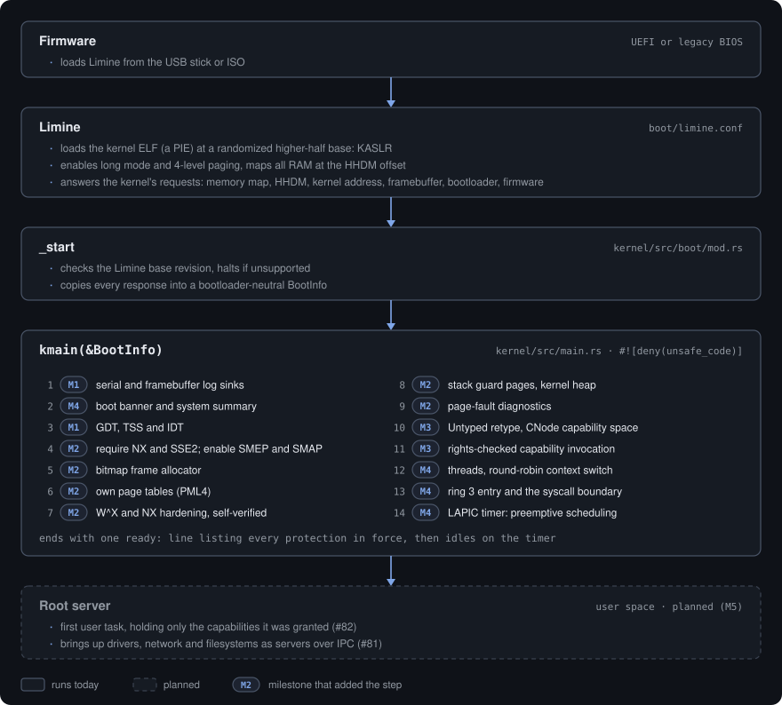

# Boot Process

> Status: **implemented** (M0 onward; updated as `kmain` grows).

## Sequence

  

`kmain`'s steps are numbered in the order they run, each tagged with the
milestone that added it. The root server (dashed) is planned for M5.

## Machine state on entry (Limine protocol, x86-64)

- 64-bit **long mode**, paging on, interrupts **disabled**.
- Kernel mapped at its link address (higher half).
- All physical memory reachable through the **HHDM** at a provided offset.
- A valid stack (≥ 64 KiB).
- Limine's own GDT/IDT are in place; we install our own in `hal` before relying
  on segments or taking interrupts (M1).

## Requests we plan to use

| Request | Milestone | Used for |
|---|---|---|
| Base revision | M0 | Protocol compatibility |
| Framebuffer | M1 | Graphical log sink |
| Memory map | M2 | Frame allocator |
| HHDM | M2 | Accessing physical memory |
| Kernel address | M2 | Phys↔virt of the kernel image; KASLR base |
| Bootloader info | M4 | Bootloader name and version, for the boot banner |
| Firmware type | M4 | BIOS or UEFI, for the boot banner |
| RSDP | M6 | ACPI (for APIC/PCIe, in a server) |
| Modules | M5 | Loading the root server / initrd |
| SMP | later | Starting other cores |

## Boot banner

The first thing `kmain` prints, to serial and the framebuffer console, is the
Magnetite logo (the Fe₃O₄ element tile in ASCII) beside the wordmark, the
version and build profile, and a one-screen summary: toolchain, bootloader and
firmware, CPU and its feature flags, memory, the address layout and the KASLR
slide. Subtract that slide from backtrace addresses before `llvm-addr2line`.

The version comes from `git describe --tags --always --dirty`, stamped in by
`kernel/build.rs` with the `rustc` version and build profile. There is no
timestamp, so the same commit and toolchain print the same banner. Outside a
git checkout the crate version is used instead.

Protections switched on later in bring-up are reported once verified, in a
single `ready:` line just before the kernel idles.

All Limine-specific code is confined to the boot module so the rest of the
kernel consumes our own `BootInfo` and never the raw protocol.
